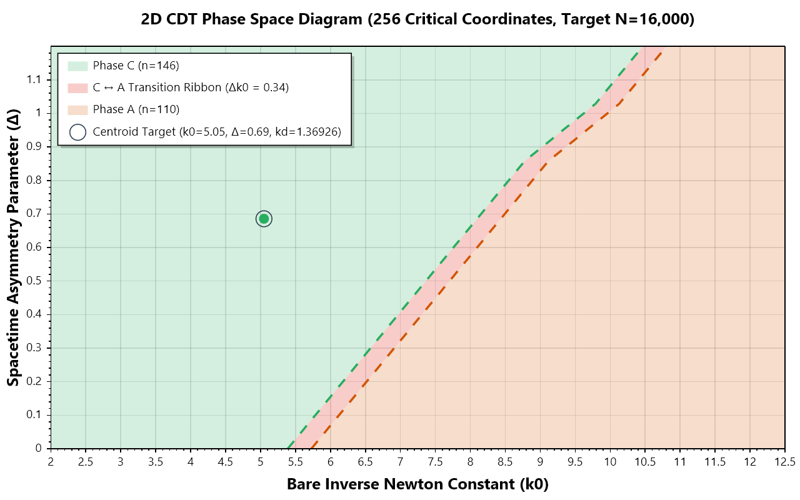
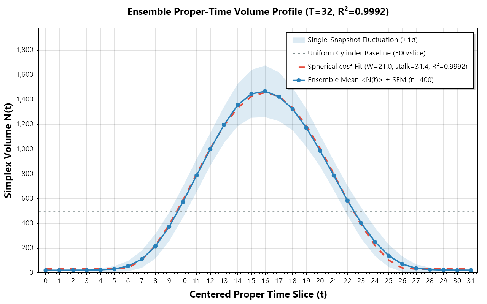
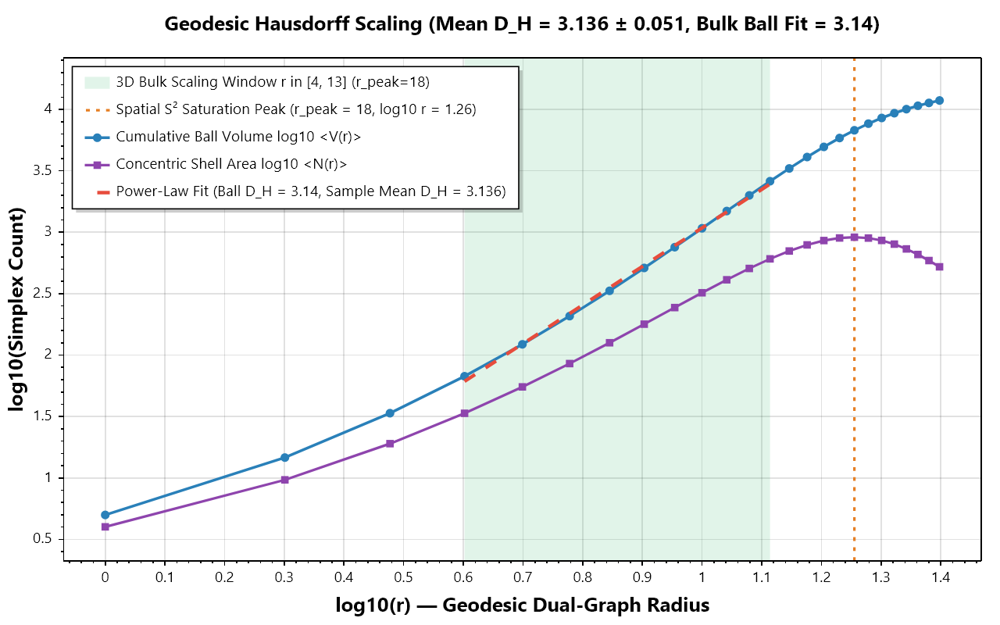

```text
      ::::::::  :::::::::  :::::::::: ::::    :::          ::::::::  ::::::::: ::::::::::: 
    :+:    :+: :+:    :+: :+:        :+:+:   :+:         :+:    :+: :+:    :+:    :+:      
   +:+    +:+ +:+    +:+ +:+        :+:+:+  +:+         +:+        +:+    +:+    +:+       
  +#+    +:+ +#++:++#+  +#++:++#   +#+ +:+ +#+         +#+        +#+    +:+    +#+        
 +#+    +#+ +#+        +#+        +#+  +#+#+#         +#+        +#+    +#+    +#+         
#+#    #+# #+#        #+#        #+#   #+#+#         #+#    #+# #+#    #+#    #+#          
########  ###        ########## ###    ####          ########  #########     ###           
```

**Open-CDT** is a high-performance, zero-allocation simulation engine and statistical analysis suite for **Causal Dynamical Triangulations (CDT)** quantum gravity.

Built around a strict **"Air-Gap" architecture**, Open-CDT pairs a managed multi-core orchestration layer with an unmanaged, cache-aligned C-ABI physics engine—delivering **~8–11M Monte Carlo proposals/sec** per CPU core (~60M proposals/sec across an 8-core ensemble on an Intel Core i9-14900K) with **0 bytes of heap allocation** and zero Garbage Collector interruptions in the hot loop.

## 2+1D Validation Benchmarks ($N_3 = 16,000, \, T = 32$)

| Automated Phase-Space Mapping | Emergent De Sitter Volume Profile |
| :---: | :---: |
|  |  |
| **256-Point $(k_0, \Delta)$ Phase Diagram:** Parallel critical-coupling calibration $k_d^c(k_0, \Delta)$, $C \leftrightarrow A$ transition ribbon, and Shoelace centroid target ($k_0 = 5.05, \, \Delta = 0.69, \, k_d^c = 1.369$). | **Classical De Sitter Droplet ($S^3$):** 8-replica ensemble mean ($n = 400$ snapshots) vs. spherical $\cos^2$ fit ($W = 21.0$, stalk $= 31.4$, **$R^2 = 0.9992$**). |
| **Geodesic Hausdorff Dimension ($D_H$)** | **Running Spectral Dimension ($D_S(\sigma)$)** |
|  |  |
| **Dual-Graph Wavefront BFS:** Cumulative geodesic ball scaling $V(r) \propto r^{D_H}$ over $r \in [4, 13]$ yielding **$D_H = 3.136 \pm 0.051$** (bulk ball fit **$3.14$**) prior to $S^2$ saturation. | **Dynamic Dimensional Reduction:** Deterministic dual-graph heat-kernel diffusion ($\chi = 0.8$) flowing from **$D_S(\text{UV}) = 2.07$** to **$2.71$** (asymptote **$D_\infty = 2.85$**). |

## Key Capabilities

* **Unmanaged Cache-Sympathetic Engine (`CDT-Agnostic` & `CDT-2plus1`):**
  * **64-Byte L1 Cache Alignment:** 32-byte `Tetrahedron` structs (2 per 64-byte cache line) and 64-byte `AdjacencyBlock` incidence pages.
  * **Hardware SIMD Acceleration:** 128-bit (`Vector128<int>`) vertex/facet slot resolution and 256-bit (`Vector256<int>`) AVX2 adjacency set intersections.
  * **Branchless Simplicial Topology:** All five ergodic 2+1D Pachner moves ($(2,3)$, $(3,2)$, $(2,6)$, $(6,2)$, $(4,4)$) execute via branchless bitwise masks and shift registers with $\mathcal{O}(1)$ Briggs-Torczon sparse-set (`SlotStore` / `TypeStore`) active tracking.
  * **`Q4.28` Fixed-Point Metropolis-Hastings:** Precomputes Boltzmann weights across a $\pm 5\sigma$ L1 lookup table (`MoveWeights`), replacing floating-point `Math.Exp` calls in the hot loop with single-cycle 64-bit integer ALU multiply-shifts.
* **Automated Workflows & Statistical Rigor (`Open-CDT`):**
  * **`PhaseSpaceMapper` (`Map.cdt`):** Parallel susceptibility root-finding with collinear neighbor warm-starting across $(k_0, \Delta)$ grids to calibrate the critical cosmological surface $k_d^c(k_0, \Delta)$, classify macroscopic phases (`Phase A`, `Phase B`, `Phase C`), and select the interior Phase C target via the 2D Shoelace polygon centroid.
  * **`CanonicalEnsemble` (`Run.cdt`):** Multi-replica parallel ensemble thermalization with Madras-Sokal self-consistent integrated autocorrelation time ($\tau_{\text{int}}$) windowing and decorrelated ($\ge 2\tau_{\text{int}}$) observable sampling.
  * **Dimension-Agnostic Observables & Plotting:** Built-in measurement and high-DPI ScottPlot rendering for the **Proper-Time Volume Profile** $N_d(t)$ ($\cos^{d_s}$ spherical droplet fits & Fourier harmonics), **Geodesic Hausdorff Dimension** $D_H$ (multi-origin dual-graph wavefront BFS), and **Running Spectral Dimension** $D_S(\sigma)$ (deterministic $\chi = 0.8$ dual-graph heat-kernel diffusion with leave-one-replica-out jackknife error bars).
  * **Bit-Exact `.cdtbin` Checkpointing:** Raw unmanaged buffer blitting preserves 100% bit-for-bit Markov chain trajectory identity across saves and restarts, supporting both exact continuation and modulo ($i \bmod M$) ensemble resizing.

## Repository Structure

```text
Open-CDT/
├── benchmarks/
│   └── CDT-Benchmarks/           — BenchmarkDotNet suite (throughput, SIMD, LUTs & JIT disassembly)
├── config/
│   └── 2plus1/                   — Example YAML configurations (Map.cdt, Run.cdt)
├── docs/                         — Architecture, topology, mathematical, and user reference docs
├── src/
│   ├── CDT-Agnostic/             — Dimension-blind arenas, Pcg32, Q4.28 LUTs, POH traces, observables
│   ├── CDT-2plus1/               — 2+1D manifold, geodesic seeder, 5 branchless Pachner moves, C-ABI engine
│   ├── Open-CDT/                 — Workflows, parallel tuner, thermalizer, sampler, checkpoints, plots
│   └── Open-CDT-CLI/             — Command-line interface & live multi-core console dashboard
└── tests/
    ├── CDT-Agnostic-Tests/       — Unit tests for allocators, adjacency, RNG, thermodynamics & observables
    ├── CDT-2plus1-Tests/         — Unit & algebraic reversibility tests for 2+1D topology, moves & checkpoints
    ├── Open-CDT-Tests/           — Unit tests for workflows, jobs, statistics, checkpoints, CSVs & plots
    └── Open-CDT-CLI-Tests/       — Unit tests for CLI routing, console dashboard formatting & headless logging
```

## Quick Start

### Option A: Running Pre-Built Releases (Zero Dependencies)
Pre-built releases of `open-cdt` (Windows `win-x64` and Linux `linux-x64`) are completely self-contained and require **no .NET runtime or SDK installation**:

```bash
# 1. Map the (k0, Delta) phase diagram and locate Phase C:
./open-cdt simulate config/2plus1/Map.cdt

# 2. Run a multi-replica canonical ensemble at a target coordinate:
./open-cdt simulate config/2plus1/Run.cdt

# 3. Generate diagnostic and publication plots from an output directory:
./open-cdt plot <path-to-output-directory>
```

### Option B: Building, Testing & Benchmarking From Source
Building from source requires the **.NET 10.0 SDK** (`dotnet --version` $\ge$ `10.0`). Always build and run physics simulations and benchmarks in **Release** configuration so full RyuJIT inlining, SIMD intrinsics, and dead-code elimination are active:

```bash
dotnet build -c Release
dotnet test -c Release --no-build

dotnet run -c Release --project src/Open-CDT-CLI -- simulate config/2plus1/Run.cdt
dotnet run -c Release --project src/Open-CDT-CLI -- plot <path-to-output-directory>
dotnet run -c Release --project benchmarks/CDT-Benchmarks -- --filter *
```

## Documentation

| Document | Contents |
| :--- | :--- |
| **[01-Engine-Architecture.md](docs/01-Engine-Architecture.md)** | Three-tier Air-Gap design, 64B cache-aligned `Manifold` & `AdjacencyBlock` arenas, `SlotStore`/`TypeStore` sparse-sets, why memory linearisation is omitted, `Q4.28` LUT thermodynamics, POH telemetry, and `.cdtbin` checkpointing. |
| **[02-Topology-And-Pachner-Moves.md](docs/02-Topology-And-Pachner-Moves.md)** | 2+1D foliation invariants, 128-bit SIMD `Tetrahedron` layout, 64-bit barycentric `GeodesicSphere` & `Icosahedral` ($S^2 \times S^1$) seeding, and the branchless bitwise mechanics of all 5 Pachner moves (`Move23`, `Move32`, `Move26`, `Move62`, `Move44`). |
| **[03-Mathematical-Compendium.md](docs/03-Mathematical-Compendium.md)** | Derivations of the 2+1D Wick-rotated Regge action, saddle-point critical tuning slope ($-1/2\epsilon$), thermal fluctuation width ($\sigma = 1/\sqrt{2\epsilon}$), combinatorial Hastings ratios, Madras-Sokal $\tau_{\text{int}}$ windowing, and observable scaling laws ($N_d(t)$, $D_H$, $D_S(\sigma)$). |
| **[04-User-And-Workflow-Guide.md](docs/04-User-And-Workflow-Guide.md)** | Complete `.cdt` YAML schema, `PhaseSpaceMapper` and `CanonicalEnsemble` operational workflows, `.cdtbin` ensemble checkpointing, CSV schemas, and the 18-chart reference table. |
| **[05-Performance-Benchmarks.md](docs/05-Performance-Benchmarks.md)** | `BenchmarkDotNet` empirical receipts: `8–11M proposals/s` single-core throughput (`60M/s` 8-core ensemble), `0 B` heap allocation proof, 25,000-sweep fragmentation immunity test, SIMD/LUT speedups, and RyuJIT x86-64 disassembly. |

## References & Prior Open-Source Implementations

### Foundational Physics & Methods Literature
* **Ambjørn, J., Jurkiewicz, J., & Loll, R. (2000).** *"A non-perturbative Lorentzian path integral for gravity."* Physical Review Letters, 85(5), 924–927. [arXiv:hep-th/0002050]
* **Ambjørn, J., Jurkiewicz, J., & Loll, R. (2001).** *"Non-perturbative 3D Lorentzian quantum gravity."* Physical Review D, 64(4), 044011. [arXiv:hep-th/0011276]
* **Ambjørn, J., Jurkiewicz, J., & Loll, R. (2005a).** *"Reconstructing the Universe."* Physical Review D, 72(6), 064014. [arXiv:hep-th/0505154]
* **Ambjørn, J., Jurkiewicz, J., & Loll, R. (2005b).** *"The Spectral Dimension of the Universe is Scale Dependent."* Physical Review Letters, 95(17), 171301. [arXiv:hep-th/0505113]
* **Benedetti, D., & Henson, J. (2009).** *"Spectral geometry as a probe of quantum spacetime."* Physical Review D, 80(12), 124036. [arXiv:0911.0401]
* **Görlich, A. (2010).** *"Causal Dynamical Triangulations in Four Dimensions."* PhD Thesis, Jagiellonian University. [arXiv:1111.6938]
* **Brunekreef, J., Görlich, A., & Loll, R. (2024).** *"Simulating CDT quantum gravity."* Computer Physics Communications, 300, 109170. [arXiv:2310.16744]

### Prior Open-Source CDT Codebases
* **[CDT-plusplus](https://github.com/acgetchell/CDT-plusplus) (Adam Getchell et al.):** Open-source C++ implementation of Causal Dynamical Triangulations using CGAL; referenced during initial verification of 2+1D ergodic move topological invariants.
* **[2d-cdt](https://github.com/JorenB/2d-cdt) & [3d-cdt](https://github.com/JorenB/3d-cdt) (Joren Brunekreef, Andrzej Görlich, & Renate Loll):** Open-source C++ companion implementations to Brunekreef, Görlich & Loll (2024) for 1+1D and 2+1D CDT.

*(A complete bibliography including simplicial geometry, MCMC statistics, and data-structure references is maintained in [docs/03-Mathematical-Compendium.md](docs/03-Mathematical-Compendium.md)).*

## AI-Assisted Development Disclosure

Large Language Models (LLMs) were used during the development of this repository as interactive pair-programming, code-refactoring, and documentation assistants. All systems architecture decisions, simplicial topology algorithms, mathematical formulations, unit and algebraic reversibility test suites, and physical validation benchmarks against published Causal Dynamical Triangulations literature were designed, audited, and verified by the author, who assumes full responsibility for the correctness and scientific integrity of the software.