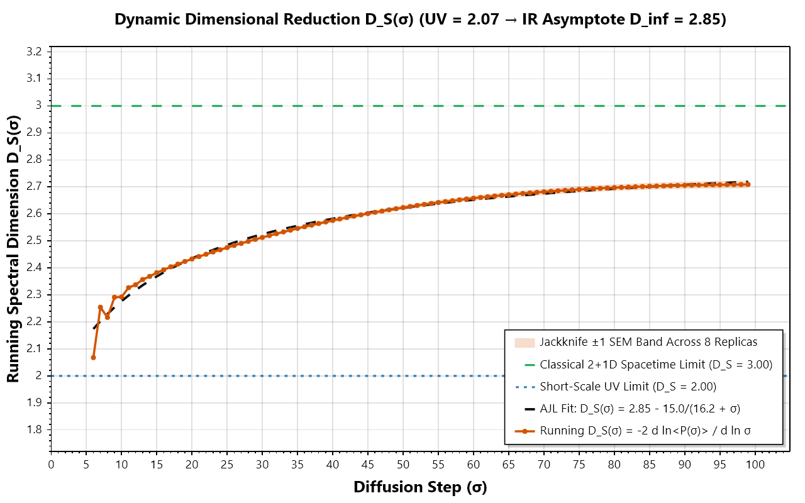

```text
      ::::::::  :::::::::  :::::::::: ::::    :::          ::::::::  ::::::::: ::::::::::: 
    :+:    :+: :+:    :+: :+:        :+:+:   :+:         :+:    :+: :+:    :+:    :+:      
   +:+    +:+ +:+    +:+ +:+        :+:+:+  +:+         +:+        +:+    +:+    +:+       
  +#+    +:+ +#++:++#+  +#++:++#   +#+ +:+ +#+         +#+        +#+    +:+    +#+        
 +#+    +#+ +#+        +#+        +#+  +#+#+#         +#+        +#+    +#+    +#+         
#+#    #+# #+#        #+#        #+#   #+#+#         #+#    #+# #+#    #+#    #+#          
########  ###        ########## ###    ####          ########  #########     ###           
```

**Open-CDT** is an open-source Markov Chain Monte Carlo (MCMC) simulation framework and statistical analysis suite for Causal Dynamical Triangulations (CDT) quantum gravity.

Open-CDT uses a three-tier architecture that decouples a managed multi-core orchestration layer (`Open-CDT`) and a dimension-agnostic native simulation engine (`CDT-Agnostic`) from pluggable spacetime physics "cassettes" (`CDT-2plus1`). Implementing a new CDT model requires defining only its simplices, Pachner moves, and gravitational action in a cassette, while reusing the core memory runtime, dual-graph observables, and statistical workflows unchanged. Because the active cassette is bound and inlined at compile time, this modularity incurs no virtual-dispatch or garbage-collection overhead: validated with the 2+1D ($S^2 \times S^1$) cassette at target volume $\hat{N}_3 = 16{,}000$, the engine sustains $8.15\times 10^6$ to $11.33\times 10^6$ move proposals per second per core ($59.79\times 10^6\text{/s}$ across eight cores on an Intel Core i9-14900K) with zero managed-heap allocations during Monte Carlo evolution.

## 2+1D Validation ($\hat{N}_3 = 16{,}000$, $T = 32$)

| Automated Phase-Space Mapping | Emergent De Sitter Volume Profile |
| :---: | :---: |
|  |  |
| **256-Point $(k_0, \Delta)$ Phase Diagram:** Critical-coupling calibration $k_d^c(k_0, \Delta)$, $C \leftrightarrow A$ transition ribbon, and Shoelace centroid target ($k_0 = 5.05$, $\Delta = 0.69$, $k_d^c = 1.369$). | **De Sitter Volume Profile ($S^3$):** Eight-replica ensemble mean ($n = 400$ snapshots) against a spherical $\cos^2$ fit ($W = 21.0$, stalk $= 31.4$, $R^2 = 0.9992$). |
| **Geodesic Hausdorff Dimension ($D_H$)** | **Running Spectral Dimension ($D_S$)** |
|  |  |
| **Dual-Graph Wavefront BFS:** Cumulative ball-volume scaling $V(r) \propto r^{D_H}$ over $r \in [4, 13]$, giving $D_H = 3.136 \pm 0.051$ (bulk fit $3.14$) prior to $S^2$ saturation. | **Scale-Dependent Spectral Dimension:** Deterministic dual-graph heat-kernel diffusion ($\chi = 0.8$) rising from $D_S(\mathrm{UV}) = 2.07$ to $2.71$ ($D_\infty = 2.85$). |

## Architecture Overview

* **Tier 1 — Orchestration & Statistical Workflows (`Open-CDT`, `Open-CDT-CLI`):**
  * **`PhaseSpaceMapper` (`Map.cdt`):** Calibrates the critical bare cosmological coupling $k_d^c(k_0, \Delta)$ across $(k_0, \Delta)$ grids via the saddle-point susceptibility slope $\partial \langle N_d \rangle / \partial k_d = -1/(2\epsilon)$ with collinear neighbor warm-starting, classifies macroscopic phases (`Phase A`, `Phase B`, `Phase C`), and selects an interior `Phase C` operating point via the 2D Shoelace polygon centroid.
  * **`CanonicalEnsemble` (`Run.cdt`):** Evolves independent multi-replica ensembles in parallel with deterministic burn-in, Madras–Sokal self-consistent integrated autocorrelation time ($\tau_{\mathrm{int}}$) windowing, and decorrelated ($\ge 2\tau_{\mathrm{int}}$) observable sampling.
  * **Checkpointing & Visualization:** Supports bit-exact `.cdtbin` binary checkpointing with direct continuation ($i < M$) and modulo ($i \bmod M$) ensemble expansion, CSV dataset persistence, and automated diagnostic and publication plotting (`open-cdt plot`).
* **Tier 2 — Dimension-Agnostic Native Engine (`CDT-Agnostic`):**
  * **Sub-Simplex-Free Native Arenas:** Represents manifolds directly through vertices and top-dimensional simplices in 64-byte cache-aligned native slab arenas and paged vertex-incidence lists (`AdjacencyBlock`), paired with $\mathcal{O}(1)$ Briggs–Torczon sparse-set (`SlotStore` / `TypeStore`) active-index tracking.
  * **Thermodynamics & PRNG:** Precomputes Boltzmann weights across a $\pm 5\sigma$ lookup window (`MoveWeights`) in unsigned 32-bit `Q4.28` fixed-point format alongside pipelined `Pcg32` + Lemire bounded integer sampling, falling back to 64-bit floating-point evaluation during out-of-window seed inflation.
  * **Dual-Graph Observables:** Dimension-independent implementations of the proper-time volume profile $N_d(t)$, multi-origin geodesic-shell Hausdorff scaling $D_H$, and deterministic $\chi = 0.8$ heat-kernel diffusion for the running spectral dimension $D_S(\sigma)$.
* **Tier 3 — 2+1D Physics Cassette (`CDT-2plus1`):**
  * **Simplicial Geometry & Seeding:** 32-byte `Tetrahedron` records (two per 64-byte cache line), 128-bit `Vector128<int>` slot resolution, 256-bit AVX2 `Vector256<int>` link-condition intersections, and deterministic icosahedral geodesic ($S^2 \times S^1$) seeding (`GeodesicSphere`, `Icosahedral`).
  * **Foliated Pachner Moves:** Branchless implementations of all five ergodic 2+1D moves—$(2,3)$, $(3,2)$, $(2,6)$, $(6,2)$, and $(4,4)$—bound into `ProposalPipeline` via `static abstract` struct-constrained interfaces.

## Repository Structure

```text
Open-CDT/
├── benchmarks/
│   └── CDT-Benchmarks/           — BenchmarkDotNet suite (throughput, SIMD, LUTs & JIT disassembly)
├── config/
│   └── 2plus1/                   — Example YAML configurations (Map.cdt, Run.cdt)
├── docs/                         — Architecture, topology, mathematical, workflow & benchmark docs
├── src/
│   ├── CDT-Agnostic/             — Dimension-agnostic arenas, Pcg32, LUTs, POH traces & observables
│   ├── CDT-2plus1/               — 2+1D manifold, geodesic seeder, Pachner moves & native sweep loop
│   ├── Open-CDT/                 — Workflows, tuner, classifier, thermalizer, sampler, checkpoints & plots
│   └── Open-CDT-CLI/             — Command-line interface & terminal progress/logging renderer
└── tests/
    ├── CDT-Agnostic-Tests/       — Unit tests for allocators, adjacency, RNG, thermodynamics & observables
    ├── CDT-2plus1-Tests/         — Unit & reversibility tests for 2+1D topology, moves & checkpoints
    ├── Open-CDT-Tests/           — Unit tests for workflows, jobs, statistics, checkpoints, CSVs & plots
    └── Open-CDT-CLI-Tests/       — Unit tests for CLI routing, dashboard formatting & headless logging
```

## Quick Start

### Pre-Built Standalone Releases
Pre-built single-file executables for Windows (`win-x64`) and Linux (`linux-x64`) are attached to each [GitHub Release](https://github.com/JeremyBarber/Open-CDT/releases) and require no installed .NET runtime:

```bash
# 1. Map the (k0, Delta) phase diagram and locate Phase C:
./open-cdt simulate config/2plus1/Map.cdt

# 2. Run a multi-replica canonical ensemble at a target coordinate:
./open-cdt simulate config/2plus1/Run.cdt

# 3. Render diagnostic and publication plots from a run output directory:
./open-cdt plot <path-to-output-directory>
```

### Building, Testing & Benchmarking From Source
Building from source requires the **.NET 10.0 SDK** (`dotnet --version` >= `10.0`). Build and run simulations and benchmarks in `Release` configuration so full JIT inlining and hardware intrinsics are enabled:

```bash
dotnet build -c Release
dotnet test -c Release --no-build

dotnet run -c Release --project src/Open-CDT-CLI -- simulate config/2plus1/Run.cdt
dotnet run -c Release --project src/Open-CDT-CLI -- plot <path-to-output-directory>
dotnet run -c Release --project benchmarks/CDT-Benchmarks -- --filter *
```

## Documentation

| Document | Contents |
| :--- | :--- |
| **[01-Engine-Architecture.md](docs/01-Engine-Architecture.md)** | Three-tier separation, 64-byte aligned `Manifold` & `AdjacencyBlock` arenas, `SlotStore` / `TypeStore` sparse sets, uncompacted arena design, `Q4.28` lookup tables, POH telemetry, and `.cdtbin` checkpointing. |
| **[02-Topology-And-Pachner-Moves.md](docs/02-Topology-And-Pachner-Moves.md)** | 2+1D foliation invariants, 32-byte `Tetrahedron` layout, deterministic `GeodesicSphere` & `Icosahedral` ($S^2 \times S^1$) seeding, and the five foliated Pachner moves (`Move23`, `Move32`, `Move26`, `Move62`, `Move44`). |
| **[03-Mathematical-Compendium.md](docs/03-Mathematical-Compendium.md)** | 2+1D Wick-rotated Regge action, saddle-point susceptibility ($-1/2\epsilon$), thermal volume width ($\sigma = 1/\sqrt{2\epsilon}$), Hastings proposal ratios, Madras–Sokal $\tau_{\mathrm{int}}$ windowing, and observable estimators for $N_d(t)$, $D_H$, and $D_S(\sigma)$. |
| **[04-User-And-Workflow-Guide.md](docs/04-User-And-Workflow-Guide.md)** | `.cdt` YAML schema, `PhaseSpaceMapper` and `CanonicalEnsemble` workflows, `.cdtbin` ensemble checkpointing, CSV schemas, the 18 generated plots, and Python/Slurm batch usage. |
| **[05-Performance-Benchmarks.md](docs/05-Performance-Benchmarks.md)** | `BenchmarkDotNet` measurements: single-core and 8-core sweep throughput, zero-allocation verification, 25,000-sweep arena churn test, micro-primitive speedups, and RyuJIT x86-64 disassembly. |

## Citation & License

Open-CDT is distributed under the [MIT License](LICENSE). Citation metadata is provided in [CITATION.cff](CITATION.cff).

## References

### Causal Dynamical Triangulations Literature
* **Ambjørn, J., Jurkiewicz, J., & Loll, R. (2000).** *"A non-perturbative Lorentzian path integral for gravity."* Physical Review Letters, 85(5), 924–927. [arXiv:hep-th/0002050]
* **Ambjørn, J., Jurkiewicz, J., & Loll, R. (2001a).** *"Nonperturbative 3D Lorentzian quantum gravity."* Physical Review D, 64(4), 044011. [arXiv:hep-th/0011276]
* **Ambjørn, J., Jurkiewicz, J., & Loll, R. (2001b).** *"Dynamically triangulating Lorentzian quantum gravity."* Nuclear Physics B, 610(1–2), 347–382. [arXiv:hep-th/0105267]
* **Ambjørn, J., Jurkiewicz, J., & Loll, R. (2004).** *"Emergence of a 4D world from causal quantum gravity."* Physical Review Letters, 93(13), 131301. [arXiv:hep-th/0404156]
* **Ambjørn, J., Jurkiewicz, J., & Loll, R. (2005a).** *"Reconstructing the universe."* Physical Review D, 72(6), 064014. [arXiv:hep-th/0505154]
* **Ambjørn, J., Jurkiewicz, J., & Loll, R. (2005b).** *"The spectral dimension of the universe is scale dependent."* Physical Review Letters, 95(17), 171301. [arXiv:hep-th/0505113]
* **Benedetti, D., & Henson, J. (2009).** *"Spectral geometry as a probe of quantum spacetime."* Physical Review D, 80(12), 124036. [arXiv:0911.0401]
* **Görlich, A. (2010).** *"Causal Dynamical Triangulations in Four Dimensions."* PhD Thesis, Jagiellonian University. [arXiv:1111.6938]
* **Kommu, R. (2012).** *"A validation of causal dynamical triangulations."* Classical and Quantum Gravity, 29(10), 105003. [arXiv:1110.6875]
* **Loll, R. (2019).** *"Quantum gravity from causal dynamical triangulations: a review."* Classical and Quantum Gravity, 37(1), 013002. [arXiv:1905.08669]
* **Brunekreef, J., Görlich, A., & Loll, R. (2024).** *"Simulating CDT quantum gravity."* Computer Physics Communications, 300, 109170. [arXiv:2310.16744]

### Prior Open-Source CDT Implementations
* **[CDT-plusplus](https://github.com/acgetchell/CDT-plusplus)** (Adam Getchell et al.) — C++ implementation of Causal Dynamical Triangulations built on CGAL.
* **[2d-cdt](https://github.com/JorenB/2d-cdt)** & **[3d-cdt](https://github.com/JorenB/3d-cdt)** (Joren Brunekreef, Andrzej Görlich, & Renate Loll) — Reference C++ implementations accompanying Brunekreef, Görlich & Loll (2024) for 1+1D and 2+1D CDT.

Additional references for simplicial geometry, MCMC autocorrelation estimators, random number generation, and sparse-set data structures are listed in [docs/03-Mathematical-Compendium.md](docs/03-Mathematical-Compendium.md).

## AI-Assisted Development Disclosure

Large language models were used during the development of this repository for pair-programming, code refactoring, and documentation drafting. All architectural designs, simplicial topology algorithms, mathematical formulations, verification test suites, and physical validation benchmarks were designed, reviewed, and verified by the author, who assumes full responsibility for the correctness and scientific integrity of the software.